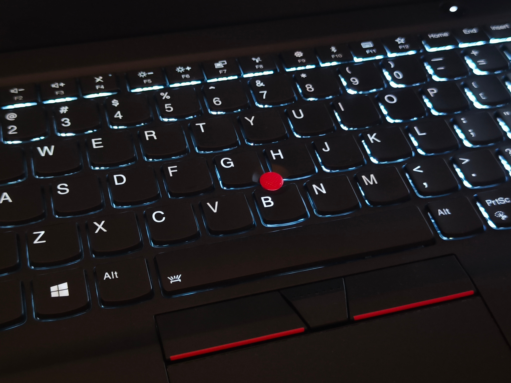
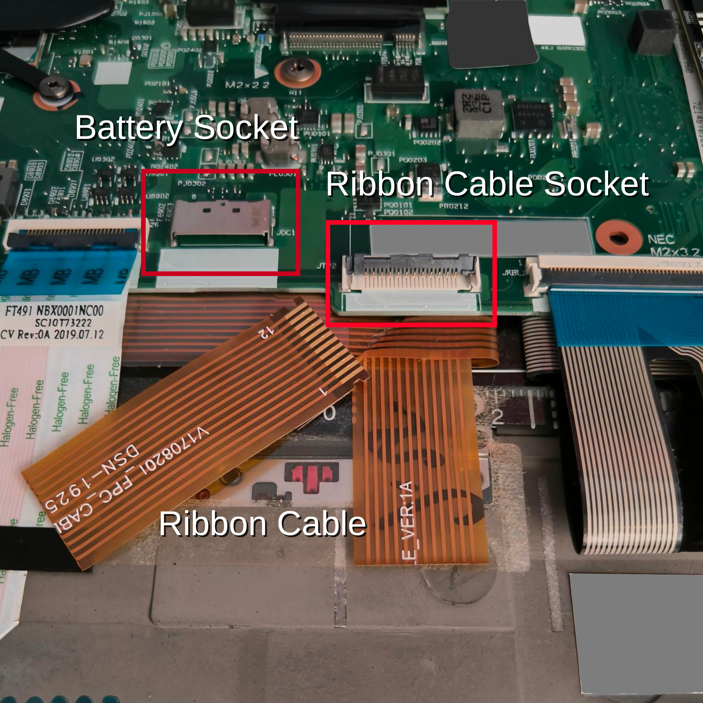
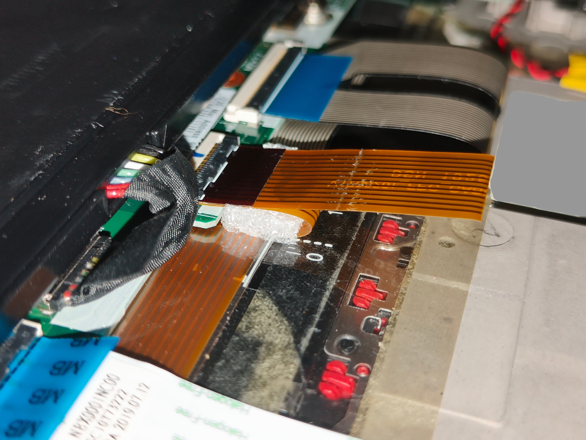
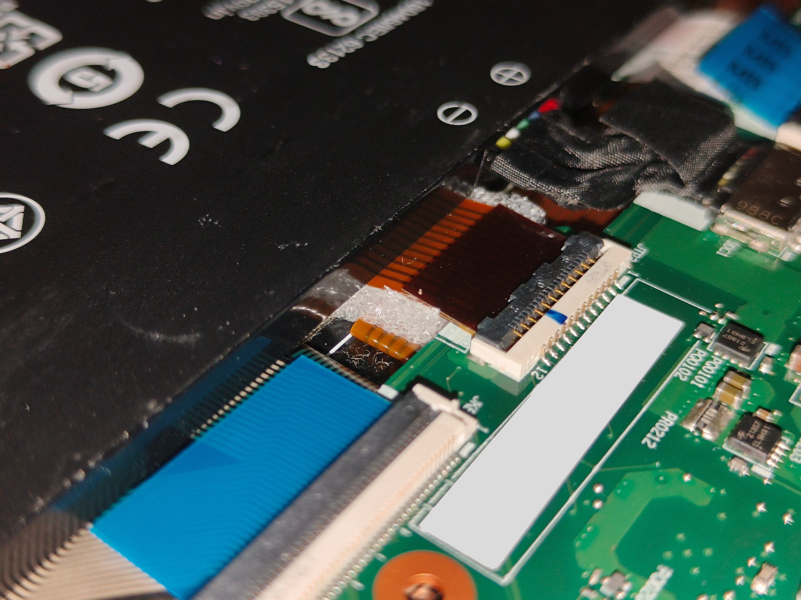

# {frontmatter.title}

Published on {new Date(frontmatter.createdAt).toLocaleDateString("en-SG")}

I got myself a used ThinkPad T490s in 2024, which has been a great joy for me. It is not the perfect, nor the best ThinkPad in recent history, but I am happy with it. However, at some point I noticed that the left-click button below the keyboard stopped working. I thought it was just the button itself that broke, but soon after the right-click button, track point and the keyboard backlight stopped working too. This got really annoying for me, as I often like to use the backlight in the dark.

I searched the internet for a solution, but I did not find anything infomation that helped me, mostly sugggesting that I update the drivers. That did not help. It was not until I came across this [Reddit post](https://www.reddit.com/r/thinkpad/comments/1ei5kl2/fixed_t490s_trackpointbacklighttrackpad_buttons/).

I thought that this was unbelievable. I opened my laptop and there I saw, a broken ribbon cable. I was shocked, then I laughed.

Just look at that clean cut!

The broken ribbon cable inside which is responsible for the broken features. It is bent over itself to connect into the motherboard, but there is a lot of pressure pressed onto it from other parts of the laptop.

## The fix

The suggested fix is to remove the broken part of the cable, and using sandpaper, expose the copper traces on the remaining length of cable.

Unplug anything from the laptop. Then open the laptop and unplug the battery, and remove it. Make sure you don't lose any screws.

Once the battery is removed, you should be able to see the broken ribbon cable. The broken part is still attached to the motherboard, while the rest of the cable is loose.

Remove the broken piece of cable by removing it from the socket on the motherboard. The socket has a clip which must be flipped up to remove the attached cable.

Using sandpaper, carefully expose the copper traces on the remaining ribbon cable. I used a piece of cardboard behind the cable, with the cable taped down, to keep it in place and protect other components. I used the sandpaper to remove the plastic encasing the copper traces, about 3mm from the edge. You can compare it with the broken piece to judge the length of the trace required to be exposed.

> [!tip]
> Have a bright light nearby, and you will be able to tell that the copper trace is exposed when it appears shiny.

> [!warning]
> Do it slowly, and check frequently. You don't want to remove too much material such that you lose the copper traces too.

Wipe the cable clean and dry, then carefully bend the now much shorter cable over itself and plug it into the socket on the motherboard. Ensure that the cable is not pressed flat, it should be a teardrop shape.

You may also insert the broken piece of cable into the socket, on top of the cable you just worked on, in order to apply a tighter fit.

I have also inserted a small piece of soft foam in between the ribbon cable where it bends over itself. Just take note that the cable has many bends in the same space.

Install the battery and plug it back into the motherboard. Check again that the cable is not pressed flat. Turn on the laptop and check that the backlight works. It should light up every time the laptop turns on.

If the backlight does not light up, remove the battery and the cable, and retry the insertion. You may also try to sand off a bit more of the cable to better expose the copper traces.

Credit to the Reddit post, otherwise I may have never found out how absurd this problem was.
